# 🚀 DOTS Survivors - Unity 高性能生存类游戏

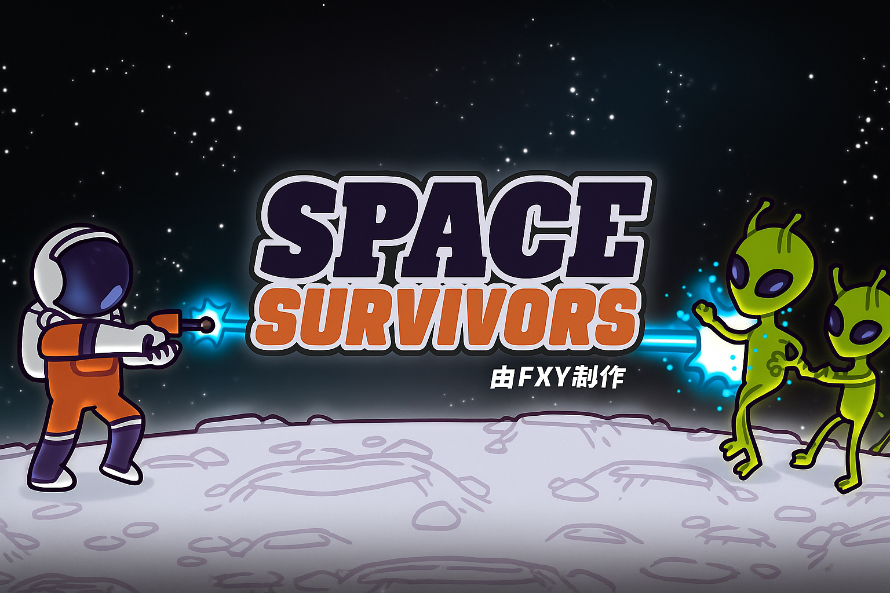

一个使用 **Unity DOTS (Data-Oriented Technology Stack)** 构建的高性能太空主题生存类游戏，展示了现代游戏开发中的最佳实践和架构设计。

## 🎮 游戏特色

### 多样化的太空关卡
| 火星 | 月球 | 金星 |
|------|------|------|
| 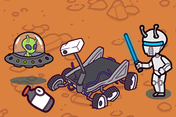 | 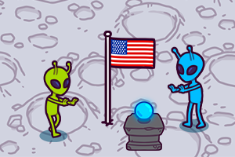 | 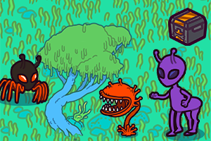 |

### 丰富的角色选择
游戏提供多种宇航员角色，每个角色都有独特的外观和属性：

<div align="center">
  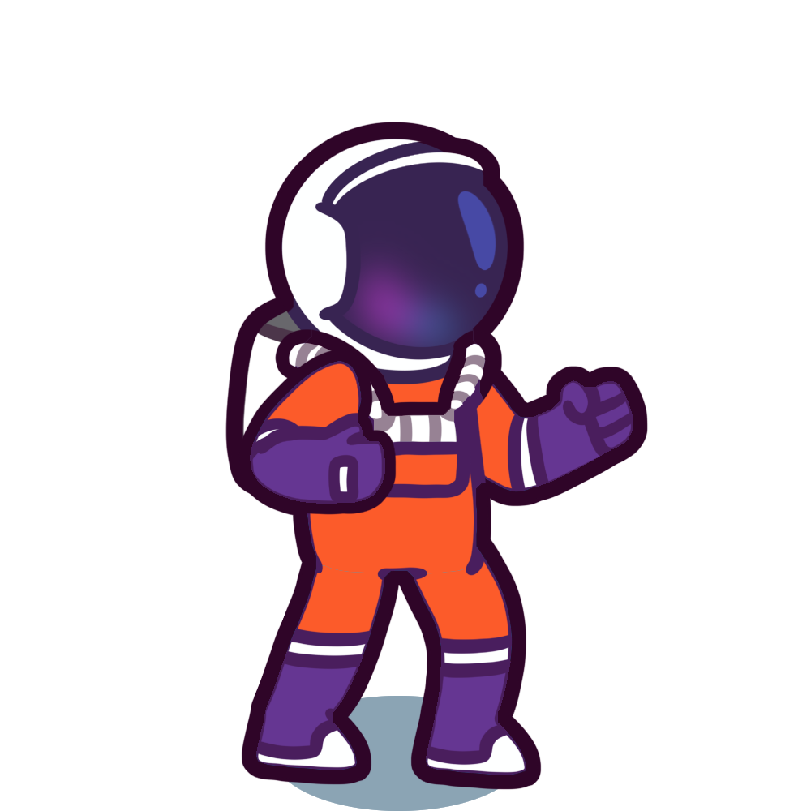
  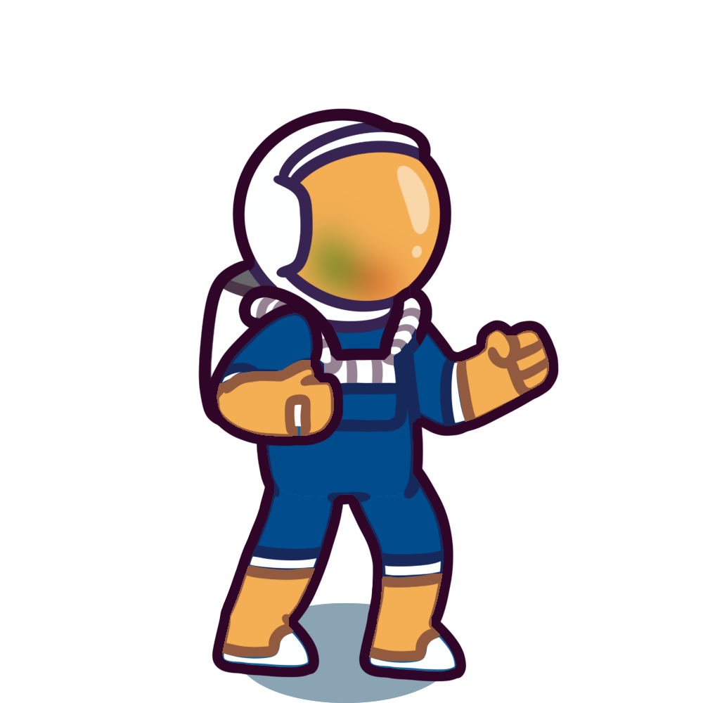
  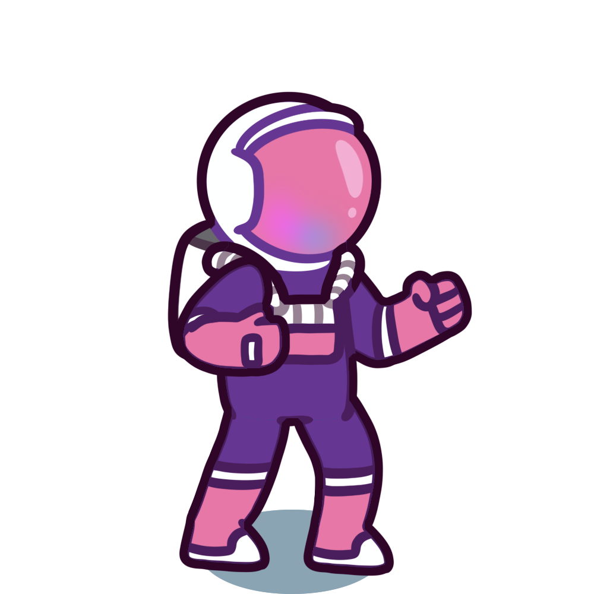
  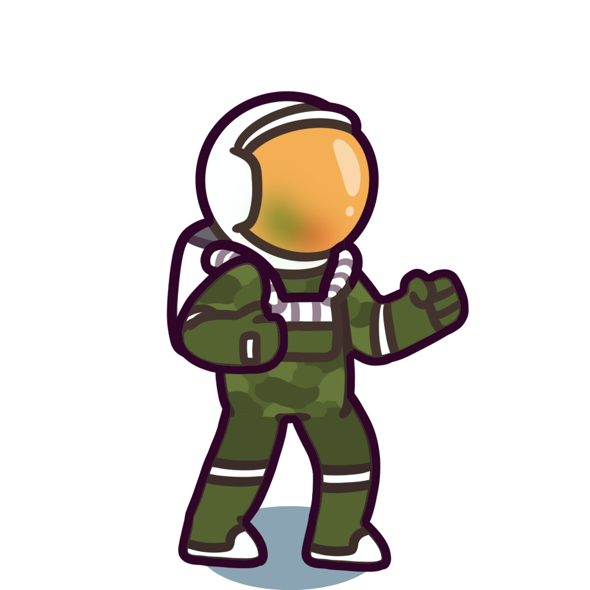
  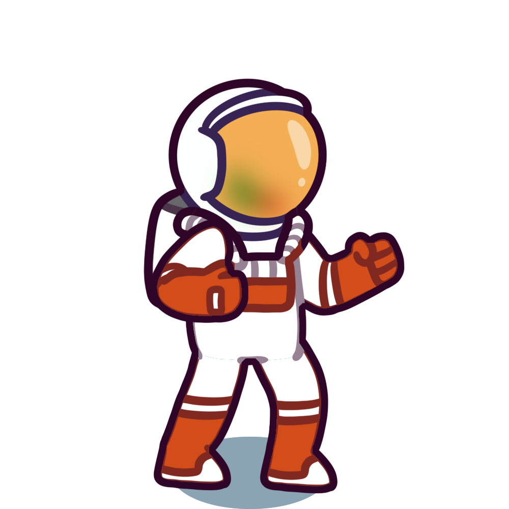
  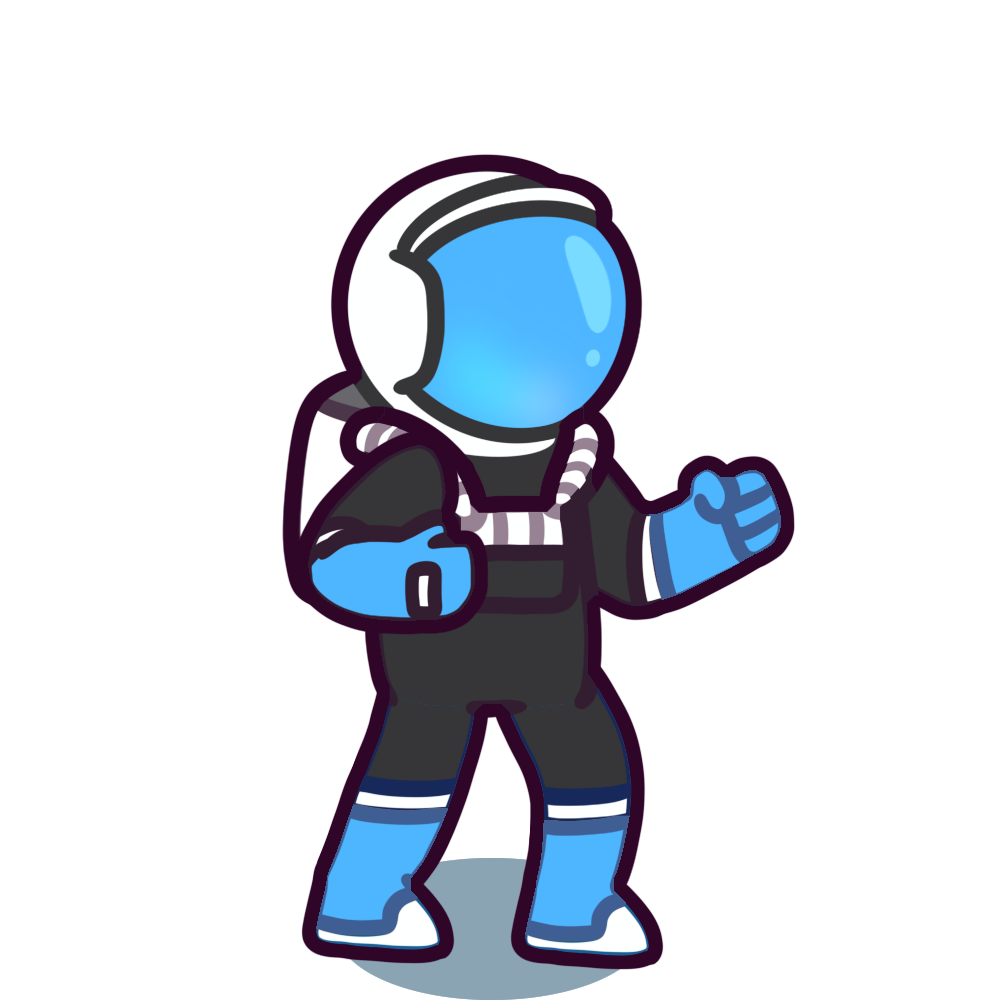
</div>

## ⚡ 技术亮点

### Unity DOTS 架构
- **实体组件系统 (ECS)**: 提供高性能的游戏逻辑处理
- **Burst 编译器**: 优化计算密集型操作
- **作业系统**: 充分利用多核处理器性能
- **手动内存管理**: 消除垃圾回收导致的性能尖峰

### 高性能设计
- 支持同屏数千个实体
- 零 GC 分配的核心游戏循环
- 数据驱动的游戏设计

## 🏗️ 项目架构

### 核心模块

#### 1. 🎯 玩家攻击系统 (PlayerAttacks)
丰富多样的武器和攻击方式：

<div align="center">
  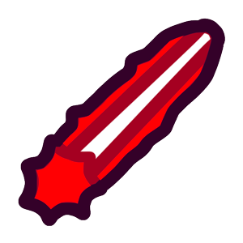
  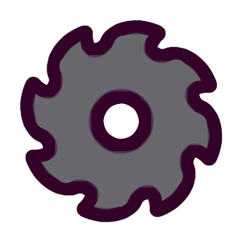
  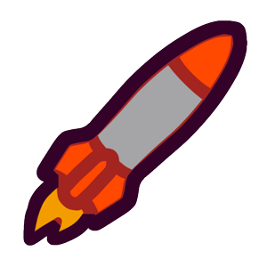
  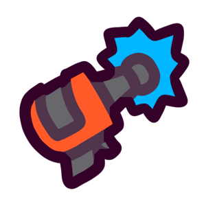
  
  
</div>

#### 2. 📈 属性修改系统 (StatModifiers)
- **数据驱动**: 使用 ScriptableObject 配置升级效果
- **可叠加修改**: 支持多个属性修改器同时生效
- **实时计算**: 动态计算最终属性值

升级道具示例：
<div align="center">
  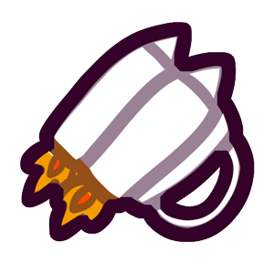
  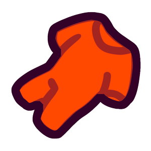
  
  
  
  
  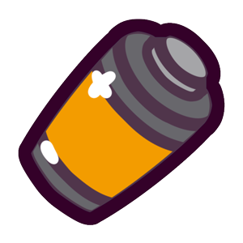
  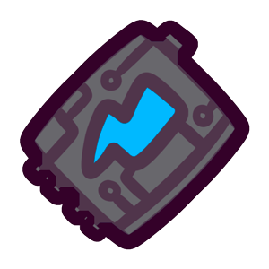
</div>

#### 3. 🎭 行为变换系统 (Transformations)
模块化的实体行为组件：
- **LinearMovementAuthoring**: 直线运动
- **ParabolicMovementAuthoring**: 抛物线运动
- **BoomerangMovementAuthoring**: 回旋镖运动
- **ConstantRotationAuthoring**: 持续旋转
- **ScaleOscillationAuthoring**: 脉冲缩放
- **BounceOnEnvironmentAuthoring**: 环境碰撞反弹
- **KnockbackAuthoring**: 击退效果

#### 4. 👾 敌人逻辑系统 (EnemyLogic)
智能AI系统，包含：
- 多样化的敌人类型
- 自适应行为模式
- 动态生成机制

#### 5. 💎 物品掉落系统 (Items)
<div align="center">
  
  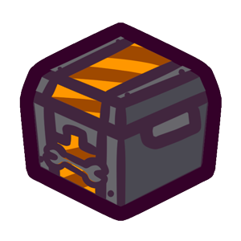
  
</div>

#### 6. 🎨 UI桥接系统
- **事件驱动**: 基于发布-订阅模式的UI更新
- **零性能开销**: 只在数据变化时更新UI
- **模块化设计**: UI组件与游戏逻辑完全解耦

## 🛠️ 开发工具与资源

### ScriptableObject 配置系统
项目大量使用 ScriptableObject 进行数据配置：
- **CharacterProperties**: 角色属性配置
- **EnemySpawnEvents**: 敌人生成事件
- **UpgradeProperties**: 升级效果配置
- **StageProperties**: 关卡属性设置

### 美术资源
- **高质量像素艺术**: 完整的太空主题美术资源
- **动画系统**: 流畅的角色和特效动画
- **音效设计**: 沉浸式的音频体验
- **UI设计**: 现代化的用户界面

## 🎯 适合学习的内容

### DOTS 开发模式
- **ECS架构设计**: 学习如何构建高性能的游戏系统
- **内存管理**: 理解 DOTS 中的手动内存管理
- **作业系统**: 掌握多线程游戏开发

### 游戏设计模式
- **组件化设计**: 通过组合实现复杂行为
- **数据驱动**: 分离配置与代码的最佳实践
- **事件系统**: 低耦合的模块间通信

### 性能优化
- **批处理**: 大量实体的高效处理
- **内存布局**: 缓存友好的数据结构
- **渲染优化**: GPU Instancing 和批处理技术

## 📋 系统要求

- **Unity版本**: Unity 6 (6000.0.30f1)
- **DOTS包**: Entities 1.0+, Burst 1.8+
- **平台**: Windows, macOS, Linux

## 🚀 快速开始

1. **克隆项目**
   ```bash
   git clone https://github.com/your-username/space-survivors.git
   ```

2. **打开 Unity**
   - 使用 Unity 6 (6000.0.30f1) 或更高版本
   - 打开项目文件夹

3. **运行游戏**
   - 打开 `Assets/DOTSSurvivors/Scenes/` 中的主场景
   - 点击播放按钮开始游戏

## 📖 文档资源

- [Unity DOTS 官方文档](https://docs.unity3d.com/Packages/com.unity.entities@latest)
- [ECS 架构指南](https://unity.com/dots)
- [Burst 编译器文档](https://docs.unity3d.com/Packages/com.unity.burst@latest)

## 🤝 贡献指南

欢迎对项目做出贡献！请查看 [CONTRIBUTING.md](CONTRIBUTING.md) 了解详细信息。

## 📄 许可证

本项目基于 [MIT License](LICENSE) 开源。

---

<div align="center">

**🌟 如果这个项目对你有帮助，请给它一个星标！**

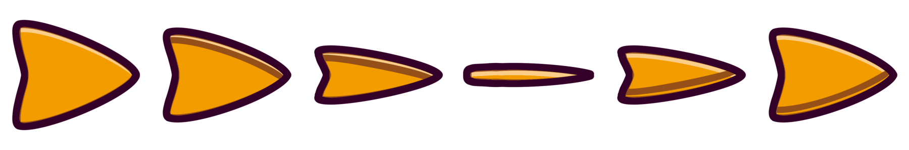

</div> 